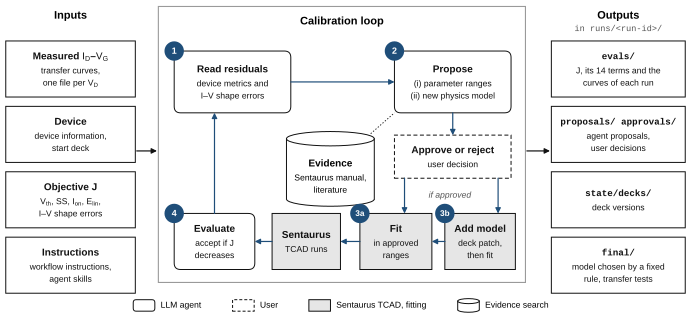

# Agentic TCAD Calibration Workflow for Oxide Semiconductor Transistors

Agentic TCAD calibration workflow for oxide semiconductor transistors and emerging devices. From the measured transfer curve and device information, the LLM agent reads measurement–TCAD residuals, proposes bounded parameter ranges or additional physics models, and accepts only updates that lower the objective J.

Maintainer/Contact: Gyujun Jeong, gjeong35@gatech.edu

## Overview

The agent reads the differences between measured and simulated curves. Numerical tools score simulations with
the 14-term objective J and fit parameters within the approved ranges.



## Implementations

| Directory | Role | LLM | Agent harness | Access |
|---|---|---|---|---|
| [`claude_code/`](claude_code/README.md) | Main calibration | Claude Opus 5.5 | Claude Code, CLI 2.1.318 | Paid Anthropic subscription or API account |
| [`nemo_fabric/nemo_fabric_on_claude_harness/`](nemo_fabric/nemo_fabric_on_claude_harness/README.md) | Open-weight LLM calibrations | NVIDIA Nemotron 3.5 Super VL | Claude Code, CLI 2.1.318 | Open-weight LLM |
| [`nemo_fabric/nemo_fabric_on_codex_harness/`](nemo_fabric/nemo_fabric_on_codex_harness/README.md) | Additional implementation | NVIDIA Nemotron 3.5 Super VL | Codex 0.154.0 | Open-weight LLM and open-source harness |

The two Nemotron implementations use NeMo Fabric 0.6.1 and the open LLM
[NVIDIA Nemotron 3.5 Super VL (120B-A12B)](https://build.nvidia.com/nvidia/nemotron-3.5-super-vl-120b-a12b/modelcard).
A local LiteLLM gateway forwards requests to NVIDIA's hosted endpoint. The Codex version pairs an open harness
with an open LLM and runs without a Claude Code installation or account.

## Getting started

Use the README for the implementation you choose. It covers installation, workspace creation, execution and proposal
review. The Claude Code version uses Python 3.11; both NeMo Fabric versions use Python 3.12 and their own dependency
lock files.

To install the main implementation and check its numerical tools on synthetic curves, run this from the package root:

```bash
cd claude_code
python3.11 -m venv env && env/bin/pip install -r ../requirements.txt
env/bin/python -m pytest -q tests
```

These tests do not need measured data, an API key or Sentaurus. Calibration requires your own device inputs,
Sentaurus installation and license. Follow the installation and run instructions for your chosen harness after
preparing those inputs.

## Using it on your own device

The device is defined in one folder: [`devices/example/`](devices/example/README.md) holds the manuscript's
transistor. For another device, copy that folder and edit it. The code does not change. The
[device setup guide](docs/device-setup.md) covers the device definition, measured-curve formats, the start deck,
Sentaurus support files, the manual index and environment variables. It also explains recalibration of a
second device and the files in each implementation.

The package contains no measured data or calibrated parameter values from the manuscript. Supply your own curves,
Sentaurus software, license and manual, material files and API keys. All implementations read measurements from
the package root's `experiment/` directory and write results to `runs/`, so use unique run IDs.

## Outputs

Look in `runs/<run-id>/workspace/` for:

- `evals/E#####.json` and `evals/E#####.png`: J, its 14 terms, device metrics and the gate offset of each simulation,
  and its curves against the measured ones.
- `proposals/`: the agent's proposals.
- `approvals/`: the user's decisions.
- `state/decks/`: deck versions.
- `notes/`: the agent's notes.

`runs/<run-id>/orchestrator/` contains the turn log and user decisions. After running `postrun.py`, look in
`runs/<run-id>/final/` for `selection.json`, `verification.json` and `transfer_tests.json` with `.csv`.

## License

MIT (see `LICENSE`). Sentaurus, Claude, Codex, NeMo Fabric and Nemotron have their own licenses and terms.

## Citation

If you use this code, please cite the following (a revised version is under review):

> **Agentic TCAD Calibration Workflow for Oxide Semiconductor Transistors**
> G. Jeong et al. (2026). *arXiv preprint.*
> [arXiv:2609.12184](https://arxiv.org/abs/2609.12184) · [DOI: 10.48550/arXiv.2609.12184](https://doi.org/10.48550/arXiv.2609.12184)

<details>
<summary>BibTeX</summary>

```bibtex
@misc{jeong2026agentictcadcalibrationworkflow,
  title = {{Agentic TCAD Calibration Workflow for Oxide Semiconductor Transistors}},
  author = {Gyujun Jeong and Junmo Lee and Sungwon Cho and Woohyun Hwang and
            Kwangyou Seo and Suhwan Lim and Wanki Kim and Daewon Ha and
            Rishi Ranade and Kihang Youn and Ram Cherukuri and Yiyi Wang and
            Asif Khan and Shimeng Yu},
  year = {2026},
  eprint = {2609.12184},
  archivePrefix = {arXiv},
  primaryClass = {physics.ins-det},
  doi = {10.48550/arXiv.2609.12184},
  url = {https://arxiv.org/abs/2609.12184}
}
```

</details>
